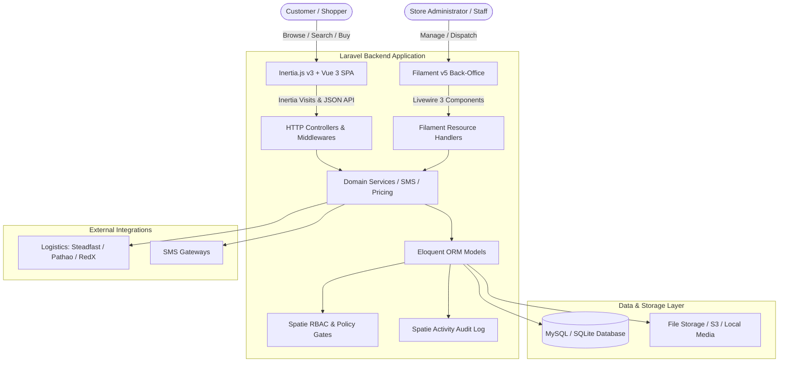

# 🍫 Nobo Shop - Full-Stack Modern E-Commerce Platform

<p align="center">
  
</p>

<p align="center">
  <a href="https://laravel.com"></a>
  <a href="https://php.net"></a>
  <a href="https://vuejs.org"></a>
  <a href="https://inertiajs.com"></a>
  <a href="https://filamentphp.com"></a>
  <a href="https://tailwindcss.com"></a>
  <a href="https://pestphp.com"></a>
  <a href="LICENSE"></a>
</p>

---

## 📖 Overview

**Nobo Shop (Choco Ecommerce)** is an enterprise-grade, high-performance E-Commerce platform engineered with **Laravel 13**, **Inertia.js v3**, **Vue 3 (Composition API)**, **Tailwind CSS v4** and **Filament v5**. 

Built for modern retail speed and operational scale, it pairs an ultra-responsive, bilingual (Bengali/English) customer-facing Single Page Application (SPA) with a comprehensive, role-guarded Filament admin dashboard for catalog control, order lifecycle management, multi-courier dispatch, real-time inventory adjustments and audit tracking.

---

## 📑 Table of Contents

- [Key Features](#-key-features)
  - [Storefront Experience](#-storefront-experience)
  - [Enterprise Admin Back-Office](#-enterprise-admin-back-office-filament-v5)
- [System Architecture](#-system-architecture)
- [Tech Stack](#-tech-stack)
- [Project Structure](#-project-structure)
- [Getting Started](#-getting-started)
  - [Prerequisites](#prerequisites)
  - [Installation Steps](#installation-steps)
- [Database Seeding & Demo Access](#-database-seeding--demo-access)
- [Automated Testing & Code Quality](#-automated-testing--code-quality)
- [Configuration & Environment Variables](#-configuration--environment-variables)
- [Contributing](#-contributing)
- [License](#-license)

---

## ✨ Key Features

### 🛍️ Storefront Experience

- **High-Performance SPA**: Seamless navigation powered by Inertia.js v3 and Vue 3 without full page reloads.
- **Dynamic Catalog & Filtering**:
  - Filter products by category, stock availability and price range.
  - Sort dynamically by latest arrival, price (low-to-high / high-to-low) and popularity.
- **Live Search & Instant Suggestions**: Debounced typeahead search offering instantaneous suggestions with product thumbnail, price and category tags.
- **Matrix Product Variants**:
  - Multi-attribute selection (Color, Size, Unit) with real time price updates and dynamic stock validation.
- **Interactive Quick View & Image Gallery**: Rich modal previews and high-resolution thumbnail switching.
- **Persistent Cart & Wishlist**: Side drawer carts and wishlists with instant quantity mutation and local persistence.
- **Frictionless Checkout**:
  - One-page responsive checkout flow.
  - Dynamic delivery charge calculation based on shipping zone (Inside Dhaka vs. Outside Dhaka).
  - Real-time coupon code discount validation (flat & percentage discounts with minimum spend constraints).
  - Cash on Delivery (COD) and Mobile Financial Services (bKash, Nagad, Rocket) selection.
- **Public Order Tracking**: Live visual milestone timeline (Pending → Confirmed → Processing → Shipped → Delivered) searchable by Order Code & Customer Phone.
- **Customer Account Portal**:
  - Self-service dashboard for past orders, order status tracking and printable web invoices.
  - Profile management, default delivery address book and security settings.
- **Verified Customer Reviews**: Rating and review submission system with verified-purchase status badges.
- **Policy & Contact Pages**: Dedicated pages for About Us, Contact (with inquiry submission), FAQ, Privacy Policy, Terms & Conditions and Return Policy.

---

### ⚙️ Enterprise Admin Back-Office (Filament v5)

- **Executive Analytics Dashboard**:
  - Real-time KPI summary widgets (Total Revenue, Total Orders, Average Order Value, Low Stock Alert).
  - Interactive Chart.js graphs for daily sales revenue and monthly order volume.
  - Visual order status distribution chart.
- **Catalog Management**:
  - **Products & Variants**: SKU generator, cost vs. selling price tracking, barcode management and rich media galleries.
  - **Attributes & Values**: Global attribute definitions (Size, Color, Material) reusable across products.
  - **Categories & Brands**: Hierarchical category tree with image upload and SEO slug generation.
  - **Units**: Measurement units (pcs, kg, box, etc.) with decimal precision.
- **Order Lifecycle & Dispatch**:
  - Strict state machine order progression with status transition audit trails.
  - Itemized printable invoices formatted for thermal or standard A4/receipt printing.
  - Courier shipment assignment and logistics tracking.
- **Logistics & Courier Integrations**:
  - Pre architected for Bangladesh couriers (Steadfast, Pathao, RedX, Paperfly).
  - Shipment parcel booking, consignment tracking codes and delivery status synchronization.
- **Warehouse & Inventory Movement**:
  - Real-time stock counts by variant.
  - Comprehensive movement audit logging (Purchases, Customer Orders, Manual Adjustments, Damage Write-offs, Customer Returns).
  - Dedicated Stock Overview page with low-stock warnings.
- **Marketing & Promotions Engine**:
  - Coupon creation with flexible rules: Fixed amount or Percentage discounts.
  - Expiry dates, minimum spend thresholds, usage caps and per-user limits.
- **Granular RBAC (Role-Based Access Control)**:
  - Powered by **Spatie Laravel-Permission**.
  - Roles: `Admin` (full system access via Gate before rule), `Manager` (operations & catalog without destructive actions), and `Staff` (order fulfillment & processing).
- **Audit Trails & Activity Logs**:
  - Integrated with **Spatie Activitylog** and Filament Activity Log for system-wide auditing of model changes.
- **System Settings & Branding**:
  - Centralized settings interface for site title, logo, footer text, contact details, social links and shipping rates.

---

## 🏛️ System Architecture



---

## 🛠️ Tech Stack

| Layer | Technology | Details |
| :--- | :--- | :--- |
| **Backend Framework** | [Laravel 13](https://laravel.com) | PHP 8.3 / 8.5, Eloquent ORM, Service Layer |
| **Admin Panel** | [Filament v5](https://filamentphp.com) | Livewire 3, Alpine.js, Tailwind-driven UI |
| **Frontend Framework** | [Vue 3](https://vuejs.org) | Composition API (`<script setup>`), Single Page App |
| **SPA Bridge** | [Inertia.js v3](https://inertiajs.com) | Server-driven client routing without REST boilerplate |
| **Styling & Design** | [Tailwind CSS v4](https://tailwindcss.com) | High-performance CSS engine with modern color tokens |
| **Icons** | [Lucide Vue Next](https://lucide.dev) | Crisp, modern SVG icon set |
| **Role & Permissions** | [Spatie Permission](https://spatie.be) | Granular roles (`Admin`, `Manager`, `Staff`) |
| **Activity Logging** | [Spatie Activitylog](https://spatie.be) | Model mutation audits & admin activity trails |
| **Testing Suite** | [Pest PHP v5](https://pestphp.com) | 84+ automated feature & regression test suites |
| **Code Style** | [Laravel Pint](https://laravel.com/docs/pint) | Automated PSR-12 & Laravel code standards |
| **Asset Bundler** | [Vite 8](https://vitejs.dev) | Lightning-fast HMR and optimized production bundling |

---

## 📂 Project Structure

```text
ecommerce-choco/
├── app/
│   ├── Enums/                 # Domain Enums (OrderStatus, PaymentMethod, ShipmentStatus, etc.)
│   ├── Filament/              # Filament v5 Back-Office Suite
│   │   ├── Pages/             # Custom Admin Pages (StockOverview, FooterSettings)
│   │   ├── Resources/         # CRUD Resources (Products, Orders, Customers, Coupons, etc.)
│   │   └── Widgets/           # KPI Stat Cards & Chart Widgets (Revenue, Order Statuses)
│   ├── Http/
│   │   └── Controllers/       # StorefrontController, CustomerAuthController, OrderInvoiceController
│   ├── Models/                # 28+ Eloquent Models with Relationships & Scopes
│   └── Services/              # Domain Services (SmsService, Couriers, Order Processing)
├── database/
│   ├── factories/             # Model factories for robust testing
│   ├── migrations/            # Relational database schema migrations
│   └── seeders/               # RolePermissionSeeder, SettingSeeder, StorefrontSeeder
├── resources/
│   ├── css/                   # Global CSS & Tailwind v4 configurations
│   ├── js/                    # Vue 3 Frontend
│   │   ├── Components/        # Header, Footer, CartDrawer, WishlistDrawer, ProductCard, QuickView
│   │   ├── Composables/       # Reusable reactive logic
│   │   └── Pages/             # Inertia Pages (Home, ProductDetail, Checkout, Customer Portal, Static)
│   └── views/                 # Root Blade layout & printable order invoices
├── routes/
│   └── web.php                # Storefront, customer auth, and invoice routes
└── tests/
    └── Feature/               # 84+ Pest PHP Feature & Regression Tests
```

---

## 🚀 Getting Started

### Prerequisites

Ensure your development environment meets the following specifications:
- **PHP**: `>= 8.3` (with extensions: `pdo`, `mbstring`, `openssl`, `tokenizer`, `xml`, `ctype`, `json`, `curl`, `bcmath`, `fileinfo`)
- **Composer**: `>= 2.7`
- **Node.js**: `>= 20.x` & **NPM**: `>= 10.x`
- **Database**: MySQL `>= 8.0` or SQLite `>= 3.35`

---

### Installation Steps

#### 1. Clone the Repository
```bash
git clone https://github.com/rakibhossainporosh/Ecommerce-choco.git
cd Ecommerce-choco
```

#### 2. Install Dependencies
```bash
# Install PHP dependencies
composer install

# Install Frontend dependencies
npm install
```

#### 3. Environment Configuration
Copy the sample environment file and configure your credentials:
```bash
cp .env.example .env
```
Generate an application encryption key:
```bash
php artisan key:generate
```

Configure your database credentials inside `.env`:
```env
DB_CONNECTION=mysql
DB_HOST=127.0.0.1
DB_PORT=3306
DB_DATABASE=ecommerce_choco
DB_USERNAME=root
DB_PASSWORD=
```

#### 4. Run Migrations & Seeders
Execute database migrations and seed default roles, categories, products and system settings:
```bash
php artisan migrate:fresh --seed
```

#### 5. Create Storage Symlink
Link the public storage directory for product images and media:
```bash
php artisan storage:link
```

#### 6. Launch the Development Environment
Run the unified development command (starts both PHP server and Vite bundler):
```bash
composer run dev
```

Alternatively, run them in separate terminal instances:
```bash
# Terminal 1: Laravel Backend
php artisan serve

# Terminal 2: Vite Dev Server
npm run dev
```

Visit the applications in your browser:
- **Storefront**: [http://localhost:8000](http://localhost:8000)
- **Admin Panel**: [http://localhost:8000/admin](http://localhost:8000/admin)

---

## 🔐 Database Seeding & Demo Access

### Creating an Admin User

To create an administrator account capable of accessing the Filament admin panel:

```bash
php artisan tinker --execute '
$user = \App\Models\User::firstOrCreate(
    ["email" => "admin@example.com"],
    [
        "name" => "Super Admin",
        "password" => \Illuminate\Support\Facades\Hash::make("password"),
        "can_access_admin_panel" => true,
    ]
);
$user->assignRole("Admin");
echo "Admin user created: admin@example.com / password\n";
'
```

### Pre-Configured Roles & Permissions
- **Admin**: Full access across all resources, configuration and security gates.
- **Manager**: Access to catalog, customer records, inventory adjustments and orders without destructive deletes or refunds.
- **Staff**: Operational order processing, picking, packing and courier dispatch.

---

## 🧪 Automated Testing & Code Quality

The project comes with **84+ comprehensive Pest PHP feature test files** verifying business rules, state transitions, security barriers and regression scenarios:

```bash
# Run the complete test suite
php artisan test

# Run tests with compact output
php artisan test --compact

# Run a specific test suite
vendor/bin/pest tests/Feature/OrderStateTransitionTest.php
```

### Code Formatting with Laravel Pint
To maintain clean, consistent and PSR-standard code:
```bash
# Automatically format code changes
vendor/bin/pint --dirty --format agent
```

---

## ⚙️ Configuration & Environment Variables

| Variable | Description | Default |
| :--- | :--- | :--- |
| `APP_NAME` | Name of the platform | `"Choco Ecommerce"` |
| `APP_URL` | Public application URL | `http://localhost:8000` |
| `APP_TIMEZONE` | System timezone | `"Asia/Dhaka"` |
| `DB_CONNECTION` | Database driver | `mysql` |
| `QUEUE_CONNECTION` | Background queue driver | `database` |
| `SESSION_DRIVER` | Session storage engine | `database` |
| `FILESYSTEM_DISK` | Storage disk for media | `public` / `local` |

---

## 🤝 Contributing

Contributions make the open-source community a better place to learn, inspire and create. Any contributions you make are **greatly appreciated**.

1. Fork the Project
2. Create your Feature Branch (`git checkout -b feature/AmazingFeature`)
3. Commit your Changes (`git commit -m 'feat: Add some AmazingFeature'`)
4. Run Code Formatter (`vendor/bin/pint`)
5. Push to the Branch (`git push origin feature/AmazingFeature`)
6. Open a Pull Request

---

## 📄 License

Distributed under the **MIT License**. See [`LICENSE`](LICENSE) for more information.

---

<p align="center">
  Crafted with ❤️ by <a href="https://github.com/rakibhossainporosh">Rakib Hossain Porosh</a>
</p>
